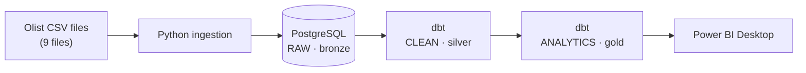

# RetailSphere

**End-to-end e-commerce data engineering and analytics project: Python → PostgreSQL → dbt → Power BI**


## Overview

RetailSphere is a portfolio project that builds a complete data pipeline on the [Brazilian E-Commerce Public Dataset by Olist](https://www.kaggle.com/datasets/olistbr/brazilian-ecommerce). Raw CSV files are ingested into PostgreSQL, cleaned and modeled with dbt following a medallion-style layering (RAW → CLEAN → ANALYTICS), and visualized in a Power BI dashboard.

**Status:** the pipeline runs end to end locally (ingestion, dbt models and tests, Power BI report).

- Last full `dbt build`: 2026-11-17 — `PASS=118 WARN=0 ERROR=0 SKIP=0 TOTAL=118` (10 views + 108 data tests).
- Power BI report built on the five `analytics` views and reviewed on 2026-11-19.

These are build results for this specific dataset snapshot, not continuously refreshed KPIs.

## Business Objectives

- Analyze monthly sales performance.
- Identify orders delivered later than expected.
- Explore sales by product category.
- Analyze returning customers.
- Evaluate customer satisfaction.

## Architecture



| Layer  | Schema      | Built with   | Purpose                                      |
| ------ | ----------- | ------------ | -------------------------------------------- |
| Bronze | `raw`       | Python + SQL | Source CSVs loaded unchanged into PostgreSQL |
| Silver | `clean`     | dbt (views)  | Typed, validated and standardized tables     |
| Gold   | `analytics` | dbt (views)  | Business-ready models consumed by Power BI   |

**CLEAN models:** `customers`, `orders`, `order_items`, `order_reviews`, `products`.

**ANALYTICS models:**

| Model                   | Question it answers                                           |
| ----------------------- | ------------------------------------------------------------- |
| `monthly_sales`         | How do revenue and average order value evolve month by month? |
| `delivery_performance`  | Which delivered orders arrived later than expected?           |
| `category_sales`        | Which product categories drive revenue and item volume?       |
| `repeat_customers`      | How many customers purchased more than once?                  |
| `customer_satisfaction` | How satisfied are customers, based on review scores?          |

## Technology Stack

Python 3.12 · PostgreSQL 18 (Docker) · dbt Core + dbt-postgres · SQL · Power BI Desktop (DAX) · WSL2 Ubuntu · Git/GitHub

## Project Structure

```text
RetailSphere/
├── compose.yaml                    # PostgreSQL via Docker Compose
├── .env.example                    # Template for local credentials
├── requirements.txt
├── data/raw/                       # Olist CSVs (git-ignored, download separately)
├── sql/
│   └── 021_create_raw_tables.sql   # RAW table definitions
├── src/                            # Python ingestion and profiling scripts
│   ├── ingest_raw.py               # Configuration-driven RAW ingestion (all 9 CSVs)
│   ├── raw_datasets.py             # Dataset definitions used by the ingestion
│   ├── ingest_orders.py
│   ├── explore_orders.py
│   ├── profile_csv.py
│   └── read_sample_csv.py
├── tests/                          # Python tests
├── dbt/retailsphere/
│   ├── macros/                     # Shared SQL macros
│   ├── models/clean/               # Silver layer
│   ├── models/analytics/           # Gold layer
│   └── tests/                      # Singular dbt data tests
├── docs/
│   ├── images/dashboard-overview.png
│   ├── RetailSphere-dashboard.pdf
│   └── RS-*.md                     # Implementation and data documentation
└── powerbi/
    └── RetailSphere.pbix           # Power BI report
```

## Quick Start

**Prerequisites:** Docker Desktop with WSL2 integration, Docker Compose, Python 3.12, and Power BI Desktop (Windows) to open the report.

### 1. Clone and install dependencies

```bash
git clone https://github.com/JCCordova-data/RetailSphere.git
cd RetailSphere
python -m venv .venv
source .venv/bin/activate
pip install -r requirements.txt
```

### 2. Start PostgreSQL

```bash
cp .env.example .env
```

Open `.env` and replace `CHANGE_ME_TO_A_STRONG_PASSWORD` with your own strong password. **Never commit `.env` to Git.**

```bash
docker compose up -d
docker compose ps
docker compose exec postgres pg_isready -U retailsphere -d retailsphere
```

Local connection: `127.0.0.1:5432` · database `retailsphere` · user `retailsphere`.

Data is stored in the Docker named volume `retailsphere_postgres_data`. Restarting the container keeps it. Avoid `docker compose down -v` unless you intend to delete the stored data.

### 3. Download the dataset

1. Download the dataset ZIP from [Kaggle](https://www.kaggle.com/datasets/olistbr/brazilian-ecommerce).
2. Extract the nine CSV files into `data/raw/`, keeping their original filenames.
3. Verify the files and confirm Git ignores them:

   ```bash
   ls -lh data/raw/
   wc -l data/raw/*.csv
   git check-ignore -v data/raw/*.csv
   ```

The original CSVs are excluded from version control through `.gitignore`. Keep them unchanged; all cleaning happens downstream in dbt.

**Data integrity:** during initial preparation, all nine extracted CSV files were verified against the downloaded ZIP archive using SHA-256 checksums, with no differences.

### 4. Create RAW tables and ingest the CSVs

```bash
docker compose exec -T postgres psql -U retailsphere -d retailsphere < sql/021_create_raw_tables.sql
python src/ingest_raw.py
```

Details of the ingestion design are in [`docs/RS-021.md`](docs/RS-021.md).

### 5. Build the CLEAN and ANALYTICS layers with dbt

```bash
cd dbt/retailsphere
dbt debug
dbt build
```

`dbt build` runs the 10 models and all data tests. See [`dbt/retailsphere/README.md`](dbt/retailsphere/README.md) for dbt-specific setup.

### 6. Open the dashboard

Open `powerbi/RetailSphere.pbix` in Power BI Desktop. To refresh against your own PostgreSQL instance, update the data source settings and enter your own credentials.

## Dashboard

- **Source:** the five `analytics` views, imported into Power BI Desktop.
- **Screenshot:** [`docs/images/dashboard-overview.png`](docs/images/dashboard-overview.png)
- **Full report (PDF):** [`docs/RetailSphere-dashboard.pdf`](docs/RetailSphere-dashboard.pdf)
- **Interactive report:** [`powerbi/RetailSphere.pbix`](powerbi/RetailSphere.pbix). Requires Power BI Desktop on Windows. GitHub shows the screenshot, not the live report.

The `.pbix` was built in Import mode, so it contains the imported Olist data (publicly released and anonymized). See [License and Attribution](#license-and-attribution).

## Testing and Data Quality

- **dbt:** 108 data tests, combining schema tests and singular tests in `dbt/retailsphere/tests/`. They cover row counts against RAW, key uniqueness, valid ranges, type checks, and reconciliation of each analytics model against the CLEAN layer.
- **Python:** tests in `tests/` cover the ingestion and profiling scripts.

## Definitions and Limitations

- Revenue excludes freight and focuses on delivered orders.
- Repeat purchase rate is all-history, not monthly retention.
- Late delivery is based on calendar dates; delivered orders with missing date fields are excluded from the denominator.
- Satisfaction considers valid review scores (1–5) for delivered orders, selects one valid review per order, and defines positive scores as 4–5. This is not NPS.
- The project is local: it does not include orchestrated scheduled refresh, CI/CD, cloud deployment, or a publicly hosted live Power BI dashboard.

## Documentation

| File                                                                                                       | Content                                                        |
| ---------------------------------------------------------------------------------------------------------- | -------------------------------------------------------------- |
| [`docs/RS-021.md`](docs/RS-021.md)                                                                         | RAW ingestion design                                           |
| [`docs/RS-036.md`](docs/RS-036.md) – [`docs/RS-039.md`](docs/RS-039.md)                                    | Data definitions, reconciliation, data quality and limitations |
| [`docs/RS-031.md`](docs/RS-031.md), [`docs/RS-032.md`](docs/RS-032.md), [`docs/RS-044.md`](docs/RS-044.md) | Additional implementation notes                                |

## License and Attribution

This project uses the [Brazilian E-Commerce Public Dataset by Olist](https://www.kaggle.com/datasets/olistbr/brazilian-ecommerce), published by Olist on Kaggle under the **CC BY-NC-SA 4.0** license. Data derived from it and included in this repository (including the data embedded in `powerbi/RetailSphere.pbix`) is shared under the same license, for non-commercial use only.

Thanks to Olist for releasing the dataset.
