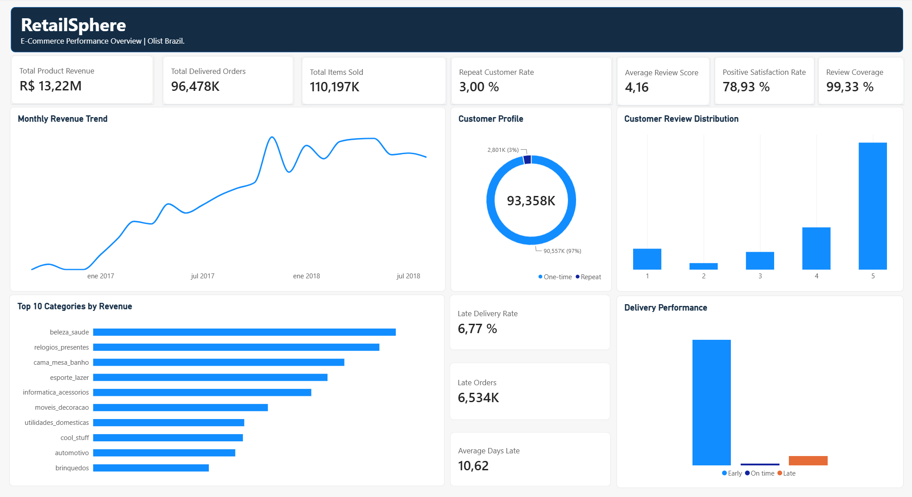

# RetailSphere

**End-to-End E-Commerce Data Engineering & Analytics Project**



## Overview

RetailSphere is a portfolio project focused on designing and building an end-to-end data engineering pipeline using the Brazilian E-Commerce Public Dataset by Olist.

The goal is to transform raw e-commerce data into reliable analytical datasets and business intelligence dashboards.

**Current status:** Local PostgreSQL 18 infrastructure is available through Docker Compose. RS-021 implements configuration-driven RAW ingestion for all nine Olist CSVs, with offline unit tests. Deployment and generalized database integration validation remain pending.

## Business Objectives

- Analyze monthly sales performance.
- Identify orders delivered later than expected.
- Explore sales by product category.
- Analyze returning customers.
- Evaluate customer satisfaction.

## Planned Architecture

Olist CSV Files → Python Ingestion → PostgreSQL RAW → SQL/dbt CLEAN → PostgreSQL ANALYTICS → Power BI

## Technology Stack

Python 3.12 · PostgreSQL (Docker) · dbt Core + dbt-postgres · SQL · Power BI Desktop (DAX) · WSL2 Ubuntu · Git/GitHub

## Project Structure

```text
RetailSphere/
├── data/
│   └── raw/
├── docs/
├── sql/
├── src/
├── tests/
├── .env.example
├── .gitignore
├── compose.yaml
└── README.md
```

## Verified project checks

The project owner executed a full `dbt build` successfully on 2026-11-17:

- 10 dbt views (5 CLEAN and 5 ANALYTICS)
- 108 data tests
- `PASS=118 WARN=0 ERROR=0 SKIP=0 TOTAL=118`

The five analytics models were imported and reviewed in Power BI Desktop on 2026-11-19. These results are dataset-specific historical benchmarks, not dynamically refreshed online KPIs.

## Local PostgreSQL Setup

**Prerequisites:** Docker Desktop with WSL2 integration and Docker Compose.

1. Create your local environment file:

   ```bash
   cp .env.example .env
   ```

2. Open `.env` and replace `CHANGE_ME_TO_A_STRONG_PASSWORD` with your own strong password. Never commit `.env` to Git.

3. Start PostgreSQL:

   ```bash
   docker compose up -d
   ```

4. Verify the service:

   ```bash
   docker compose ps
   docker compose exec postgres pg_isready -U retailsphere -d retailsphere
   ```

5. Run a test SQL query:

   ```bash
   docker compose exec postgres psql -U retailsphere -d retailsphere -c "SELECT current_database(), current_user;"
   ```

**Local connection:** `127.0.0.1:5432`

**Database:** `retailsphere`

**User:** `retailsphere`

PostgreSQL data is stored in the Docker named volume `retailsphere_postgres_data`. Restarting the container does not remove the volume. Avoid `docker compose down -v` unless you explicitly intend to delete the stored data.

## Dataset

RetailSphere uses the [Brazilian E-Commerce Public Dataset by Olist](https://www.kaggle.com/datasets/olistbr/brazilian-ecommerce).

The dataset contains nine CSV files covering orders, customers, order items, payments, reviews, products, sellers, geolocation, and product category translations.

### Raw Data Setup

1. Download the dataset ZIP archive from Kaggle.
2. Extract the nine CSV files into `data/raw/`, keeping their original filenames.
3. Verify the extracted files:

   ```bash
   ls -lh data/raw/
   wc -l data/raw/*.csv
   ```

4. Confirm that Git ignores the raw CSV files:

   ```bash
   git check-ignore -v data/raw/*.csv
   ```

The original CSV files are intentionally excluded from version control through `.gitignore`. They must be downloaded separately when setting up the project.

**Data integrity:** During initial dataset preparation, all nine extracted CSV files were verified against the downloaded ZIP archive using SHA-256 checksums. No differences were detected.

Raw source files should remain unchanged. Data cleaning and transformations will be implemented in subsequent pipeline stages.

## Dashboard

- Source: the five `analytics` views, imported into Power BI Desktop.
- Report image: [`docs/images/dashboard-overview.png`](docs/images/dashboard-overview.png).
- Power BI source file: [`powerbi/RetailSphere.pbix`](powerbi/RetailSphere.pbix) (include this line ONLY if the PBIX is committed and safe to distribute; otherwise refer to the release asset if published).
- Requirements: Power BI Desktop on Windows to interact with the `.pbix` locally. GitHub shows the screenshot, not the live interactive Power BI report.

## Reproducibility

1. Clone this repository.
2. Install/configure Docker, PostgreSQL, Python, and dbt as documented in the existing setup sections.
3. Obtain the original Olist CSV dataset from Kaggle and place it in the expected local input directory; raw data is not included in this repository unless explicitly permitted.
4. Configure local database credentials privately (never commit them).
5. Run the existing Python ingestion entry point documented in this repository.
6. From the configured dbt project, execute `dbt debug` and `dbt build`.
7. Open the `.pbix` file with Power BI Desktop. If refreshing against a different local PostgreSQL server, update the data source settings and supply your own credentials.

## Data source and limitations

Source: [Brazilian E-Commerce Public Dataset by Olist](https://www.kaggle.com/datasets/olistbr/brazilian-ecommerce).

Revenue excludes freight and focuses on delivered orders. Repeat purchase rate is all-history, not monthly retention. Late delivery is based on calendar dates, excluding delivered orders with missing date fields from the denominator. Satisfaction considers valid order review scores 1–5 for delivered orders, selects one valid review per order, and defines positive scores as 4–5. This is not NPS.

The MVP is local; it does not include orchestrated scheduled refresh, CI/CD, cloud deployment, or a publicly hosted live Power BI dashboard.

## Documentation

See `docs/RS-036.md`, `docs/RS-037.md`, `docs/RS-038.md`, and `docs/RS-039.md` for data definitions, reconciliation, data quality and limitations.